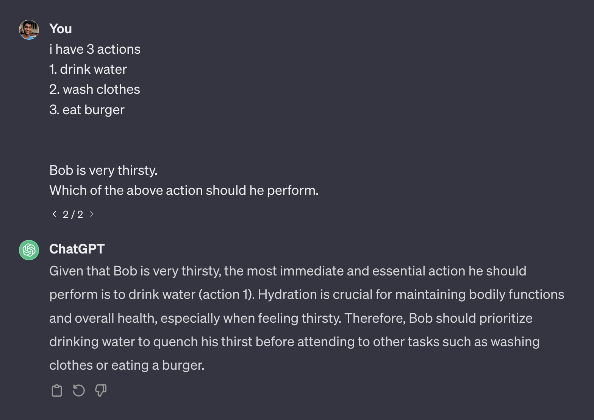
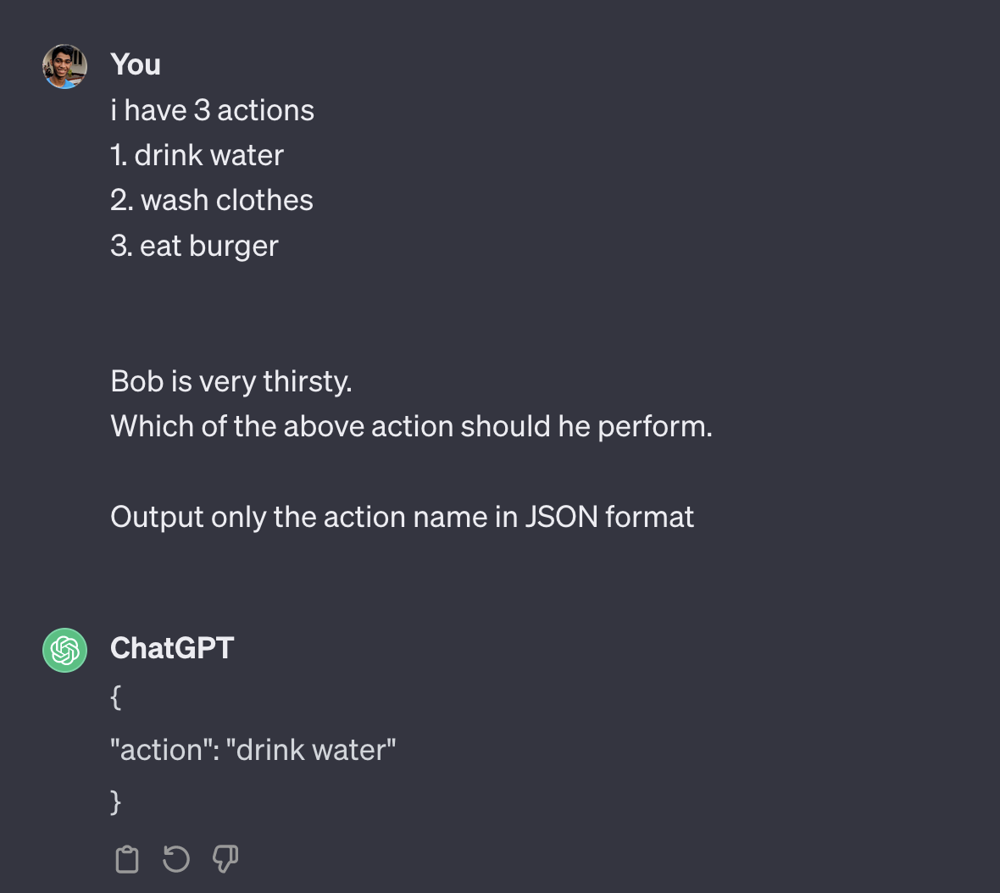
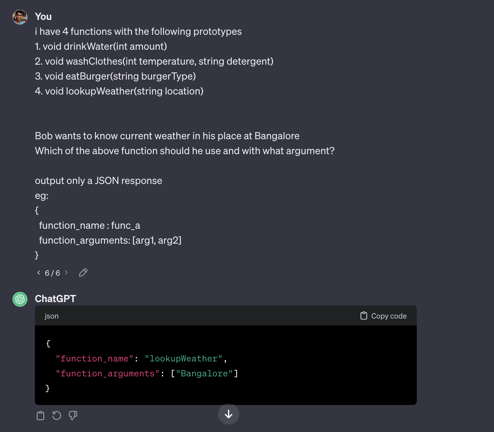
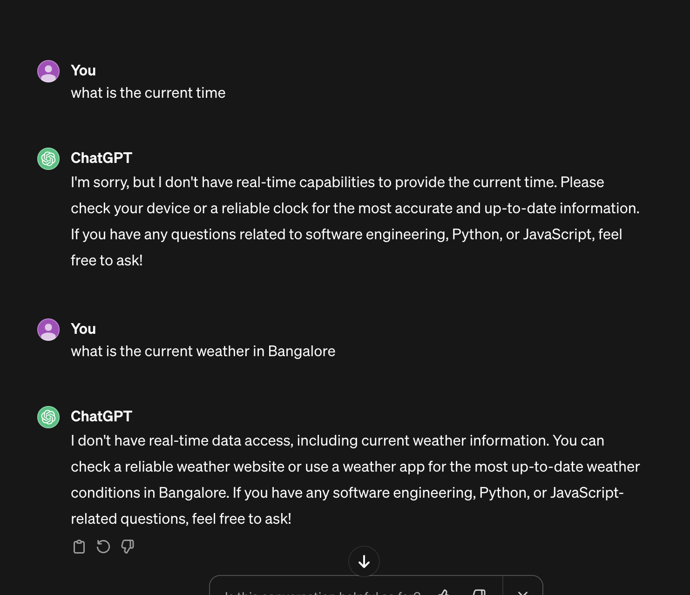
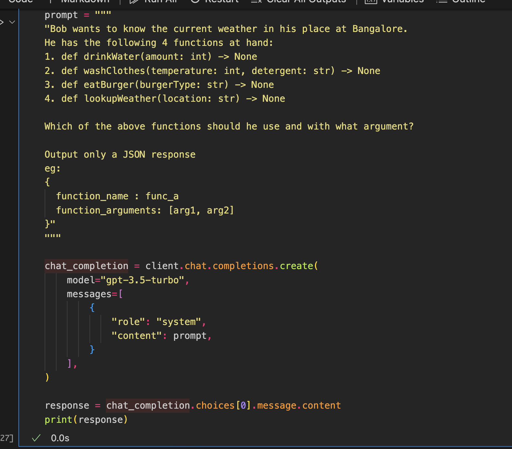

# Function **Calling**

What it is and how it works

<!-- Good evening -->
<!-- Let's learn about something new today! -->

---

Super basic refresher

---

**LLMs**

### take in text input

and

### returns text as output

---

<!-- ## LLMS -->

Good at what?

---

### **Understanding Text**

---

---

JSON Mode

---

Using Function prototypes

---

### Pause....

---

## Why do we do this?

##### Limitation of LLMs

<!-- no access to dynamic data -->

---

---

### What if

we could use **tools** to supplement

---

---

**LLMs**

### take in text input

and

### returns text as output

---

---

## Open source Options

 

https://github.com/ShishirPatil/gorilla

---

# Thank You✨

### Resources

<ul clas="left-align">
  <li class="small-text"> platform.openai.com/docs/guides/function-calling </li> 
  <li class="small-text"> github.com/aldrinjenson/aJent </li>
  <li class="small-text"> github.com/Sentdex/ChatGPT-API-Basics/blob/main/function_calling.ipynb </li>
  <li class="small-text"> python.langchain.com/docs/modules/agents/quick_start </li>
</ul>

 

<!-- 

### Jarvis Lessgoo

 -->

 
<!-- 
This presentation was built using Free Software 🤗
 -->
