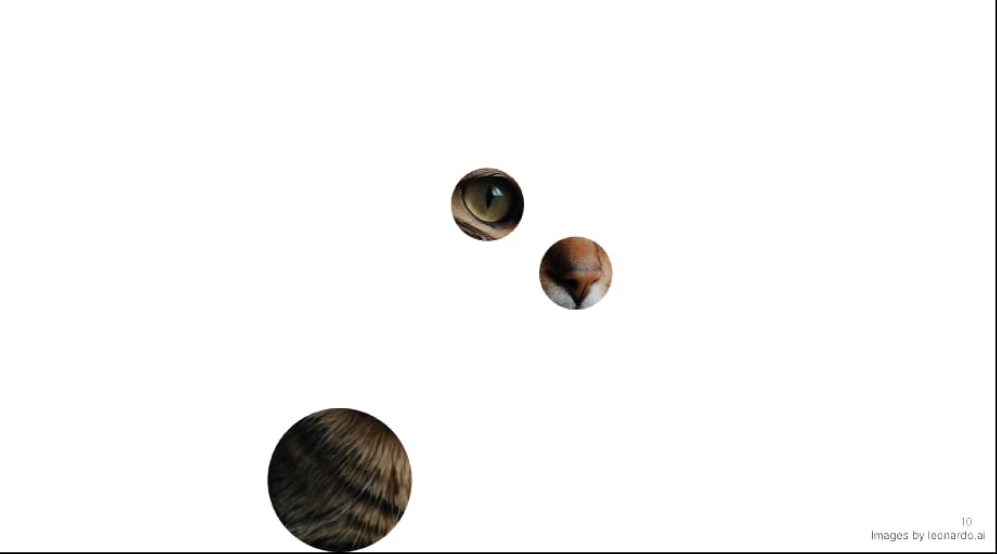
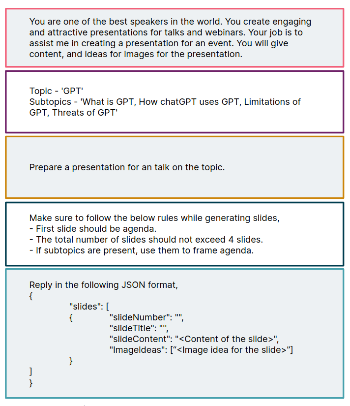

<!-- ask about students  -->
<!-- how many in college right now? -->
<!-- how many have some background in AI/ML -->
<!-- how many in computer science -->
<!-- how many know python? -->

# Hi there✨

<!-- Good evening -->
<!-- Let's learn about something new today! -->

---

### Introduction to the wonderful world of

## Generative AI

🪄

---

## Mandatory intro

---

---

## $whoami

## **Aldrin Jenson**

- Software Engineer at **Thoughtworks**
- Focussing on R&D in **Generative AI**
- Volunteer at FOSS United

### @aldrinjenson

---

## Quick questions before we start

---

1. How many here are students?
<!-- whic course -->

---

2. How many of you here are from Kerala?

---

3. how many have some background in AI/ML?

---

4. How many have already used gen-AI in projects?

---

## Agenda

1. What is generative AI
2. Comparison with traditional AI systems
3. Classification of genAI + tools
4. Why care about Gen-AI

---

## Agenda (contd.)

5. Some prompt engineering tips
6. Some interesting GenAI based projects
7. Getting started with GenAI based app development
8. Security, privacy, ethical issues
9. Resources
10. Q&A

---

Lessgoooo

---

# Introduction to

# **Generative AI**

---

What comes to your mind when you hear the word

## **Gen-AI**

?

---

- OpenAI?
- Devin ?

- SORA?
- midjourney

#notjustacadburyad.com

<!-- https://www.cognition.ai/introducing-devin -->

<!-- talk about Devin -->
<!-- talk about Sora -->

---

---

<!-- seinfield -->
<!-- https://www.youtube.com/watch?v=M6mD9YzVbZI -->

---

---

<!-- https://www.microsoft.com/en-us/research/project/vasa-1/ -->

---

---

---

<!-- bland -->

<!-- https://www.youtube.com/watch?v=r_Iy0xZ1CYY -->

---

Pause

---

## Getting Started...

---

---

---

---

## Give me a cat dressed up formally

---

---

---

---

## Classifications

Tools & Applications

---

## Text Generation

---

## Image Generation

---

## Video Generation

---

## Audio Generation

---

## Code Generation

---

# But Why? 🤔

<!-- why shouould be we care about all these? -->

---

---

- Printing Process(~1450)
- Electricity(~1880)
- Assembly Line(~1930)
- Personal Computing(~1930)
- Mobile Computing(~2007)

---

- Generative AI(~2022)

---

- Any questions so far?

---

## What are LLMs

<!-- ask people -->

---

- **Very large** AI models designed to understand and generate **human-like text**

---

- applications include natural language understanding, text generation, translation, summarization etc
- multiple layers of neural networks, typically utilizing transformer architectures.

---

## Few major examples

- ChatGPT
- https://indicsubtitler.in/livetranscribe
- https://www.chatpdf.com/
- https://www.perplexity.ai/
- https://cursor.sh

---

Any questions.?

---

## Now

---

## Using LLMs to code!

---

Let's goooo

---

## Prompting

---

# Conclusion

---

---

# Thank You✨

### Shout out to

- Sree Laxmi
- Srilakshmi
- IB Computing
- Titty Jacob Sir(MEC)

## **@aldrinjenson**

<u>aldrinjenson.tech</u>

 

This presentation was built using Free Software!

---

# Resources

- https://www.gnu.org/gnu/manifesto.html
- https://www.debian.org/
- https://www.fsf.org/
- https://www.youtube.com/watch?v=vwG5N8SCmZ8
- https://indiafoss.net/2023
- https://en.wikipedia.org/wiki/Free_software_movement

---
