<!-- # Good afternoon folks!✨ -->

<!-- Good evening -->
<!-- Let's learn about something new today! -->

Product discovery

---

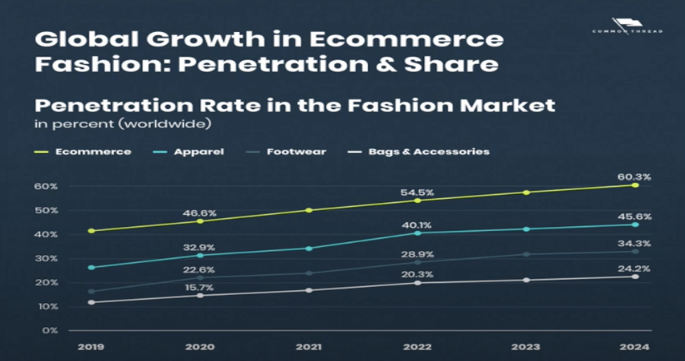

---

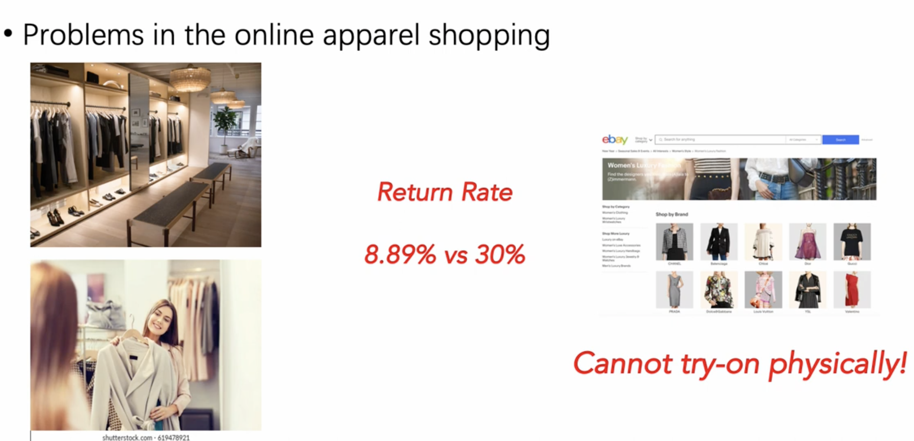

---

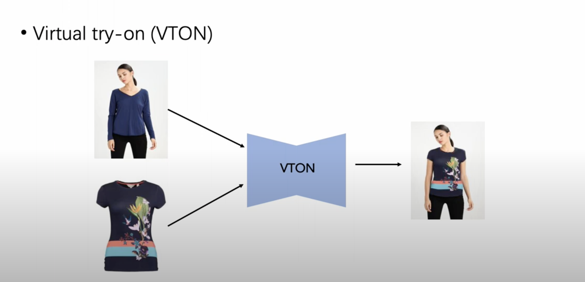

---

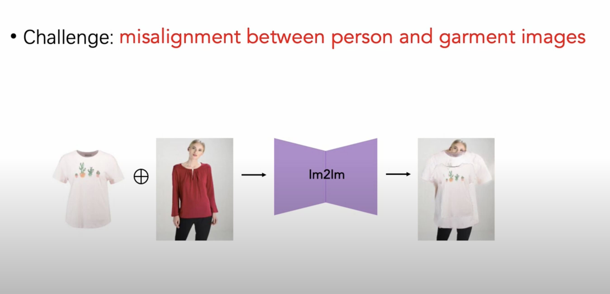

---

Outfit anyone

---

<!--  -->

https://humanaigc.github.io/outfit-anyone/

https://chrisjohnson111-test4.hf.space/

---

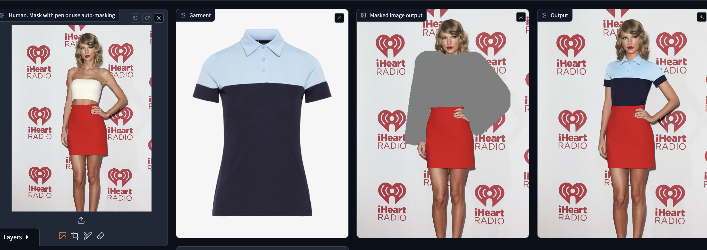

https://drive.google.com/drive/folders/1DrvndgwHbEj-B2D66lXbAxTfyPutTmjV

---

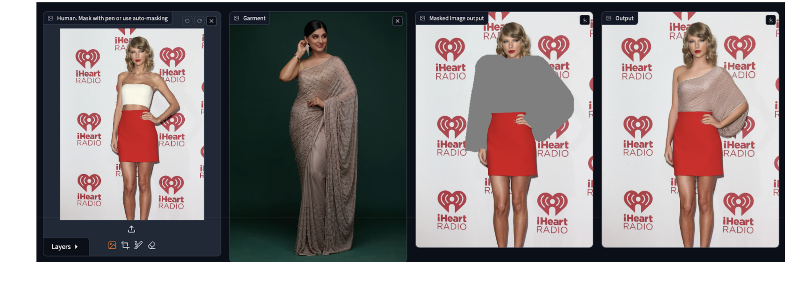

---

---

WeFocus

(demo Vid)

---

https://www.weshop.ai/workspace?agentName=model

---

## Agenda

2. 

- Agenda
- Ice breaker
30 min

- Intro about genai
- Campaign Forge
20 mins

- Personalized Pro (10 mins)

- Suno AI
(5 mins)
- Pika Art (10 mins)
+ QA

- 1.5 hrs

+ bland AI

---

---

30 mins
Outfit anyone
DeFocus
Viton
WeShop Anyone

Resleeve (Sketch to Design)

---

Patterned AI + XR

---

Energizer / stickies: 1.30 - 2:00
What all is possible in GenAI in retail. Data analytics : (Excel + PowerBI): 10 mins
Demos
- Data mining with GenAI
Demo + sprinkled with concerns

Simple Demo using ChatGPT + : eg: summarize this csv data or do visualization or list steps to follow etc
Basket analysis (15 mins)

---

15x4 = 1 hr
ChatGPT
Taskweaver
metadata 
Custom

1 hr for trying out

Caveat / Warnings: use this responsibly

---

---

---

---

###  Ice breaker

---

## What kind of Dev Tool?

- One that trainers force us to use!
- One that lets us sleep peacefully at night as a SWE
- One that could _potentially_ prevent us from being sued for millions!

---

One that makes us proud to be at **ThoughtWorks**

<!-- pause here -->
<!-- what we're going to be talking about -->

---

## Let's start with a Problem

---

## /imagine

midjourney, anyone?

---

<!--
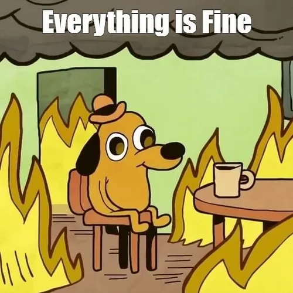

--- -->

## Well....

<!-- today is your lucky day -->
<!-- introducing the hero -->

---

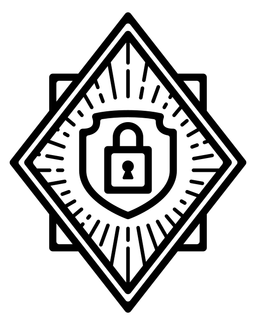

# !**Talisman**!

"Keeping your secrets safe"

<!-- written in goLang -->

---

<!-- devtool that enforces the idea of -->

### Prevention is better than cure

---

- A tool that installs a **hook** to your git repository to ensure that potential **secrets or sensitive information** do not leave the developer's workstation.

---

- It validates the outgoing changeset for things that look suspicious - such as potential **SSH keys, authorization tokens, private keys** etc.

---

## Validation

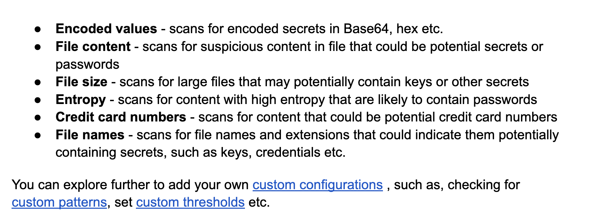

---

🤯

---

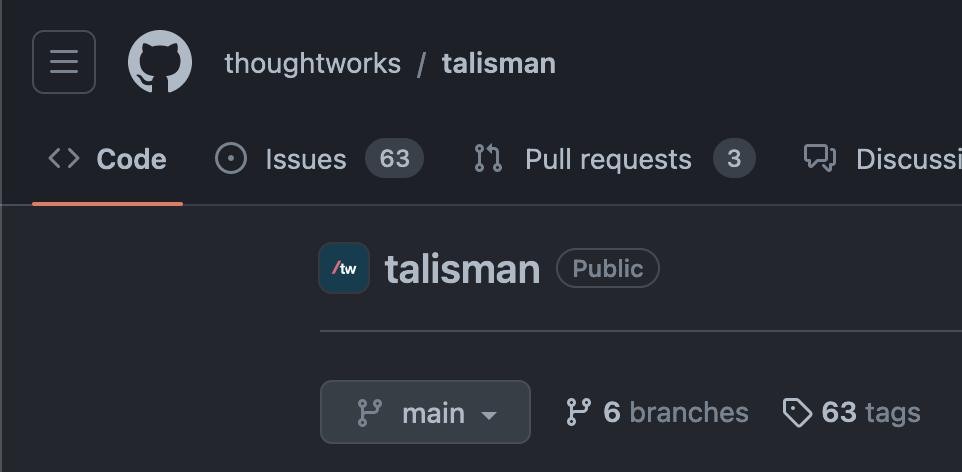

---

# Thank You✨

### Sources

- <u>github.com/thoughtworks/</u>
  <u>talisman</u>
- <u>thoughtworks.github.io/</u>
  <u>talisman/docs</u>

 

Go Star the Repo!

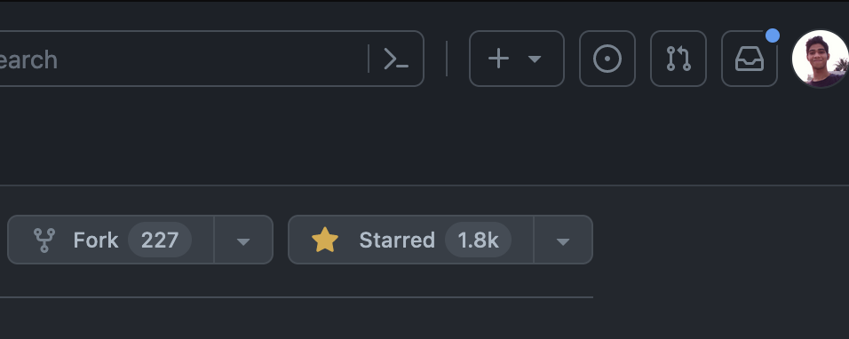

 

Made with  ❤️ by Aldrin  🤗 

