# Ollama **Experiments** ✨

<!-- Long live the Open Source revolution! -->

---

## Caveats

<!-- 1. Not much extensive testing done -->

---

## Ollama

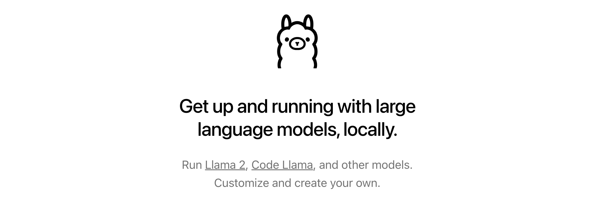

https://ollama.com/

---

## Getting started

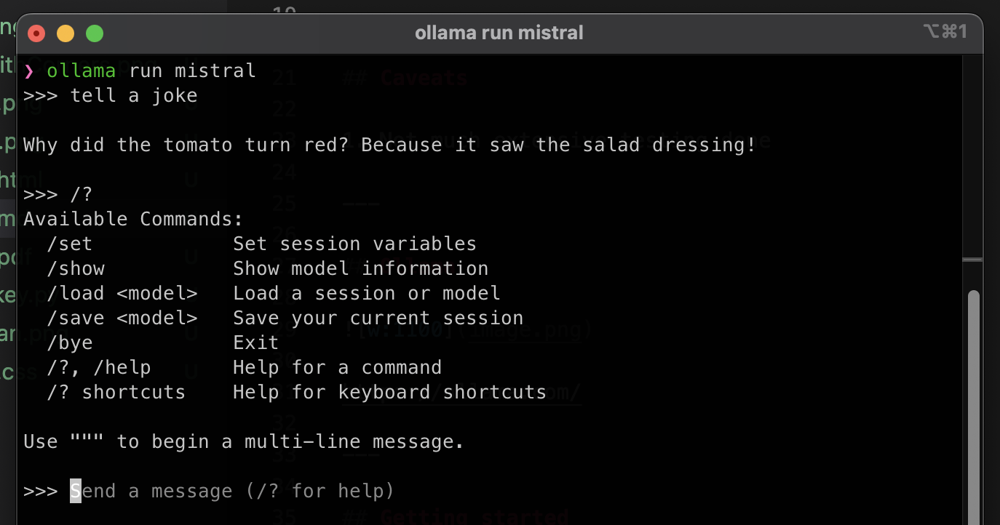

---

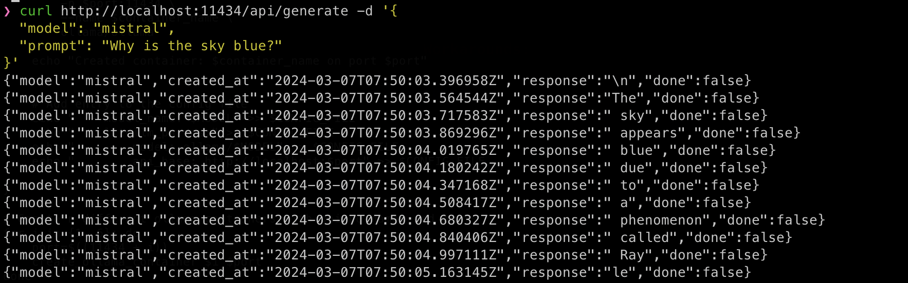

---

## Limitations

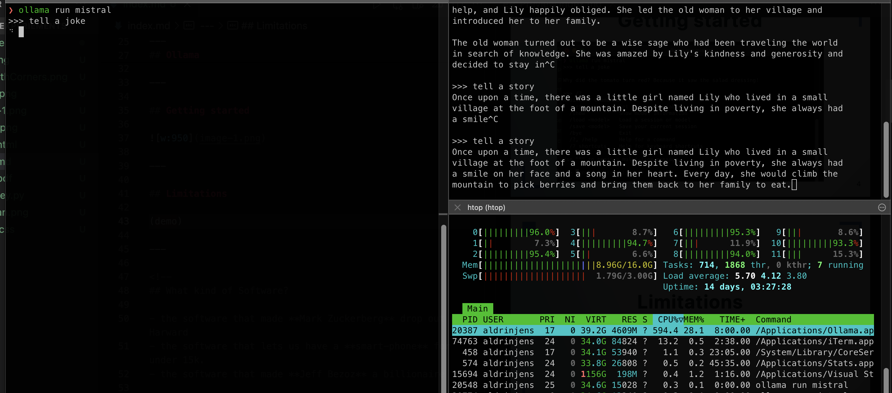

(demo)

---

For, most people this is okay.

---

## But

---

We can do better for the **BEAST**

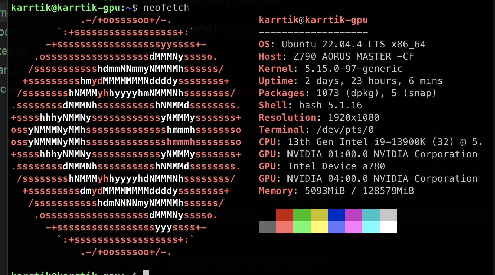

---

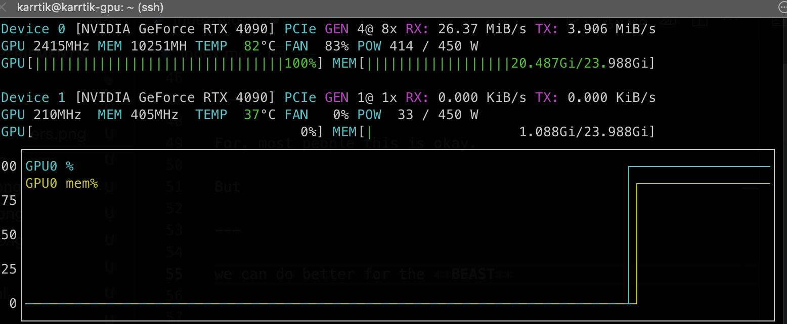

---

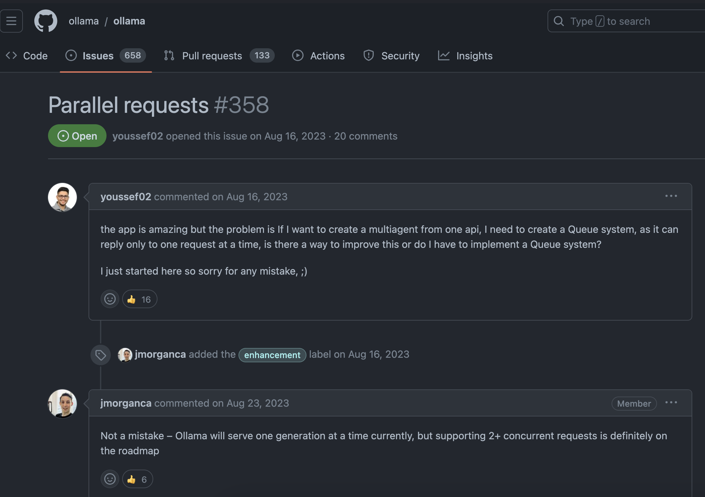

---

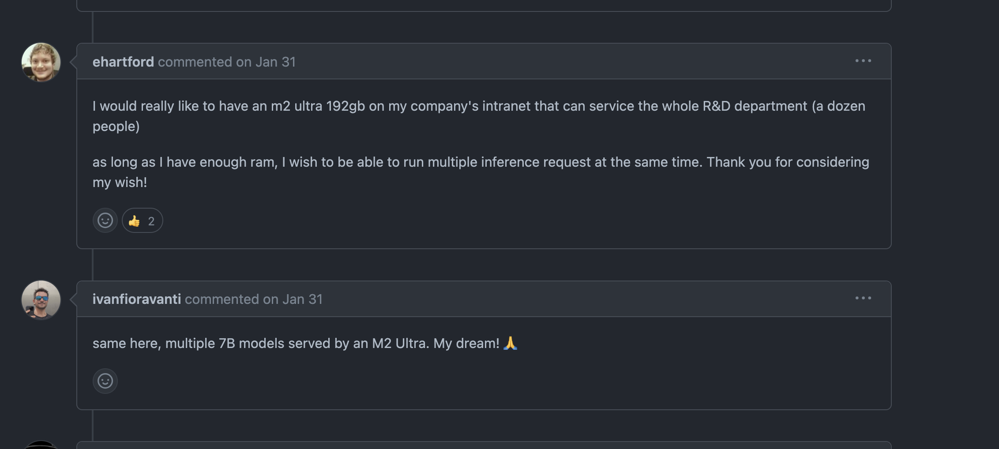

---

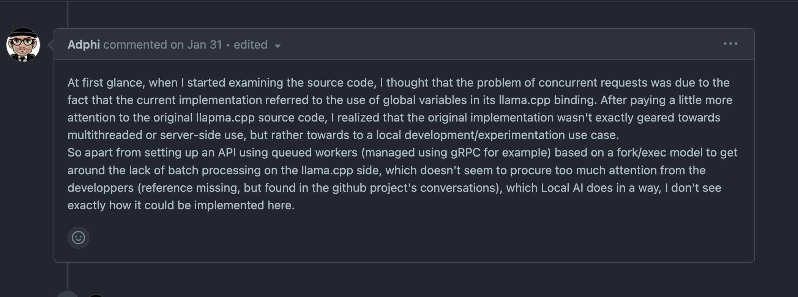

---

Docker to the rescue

---

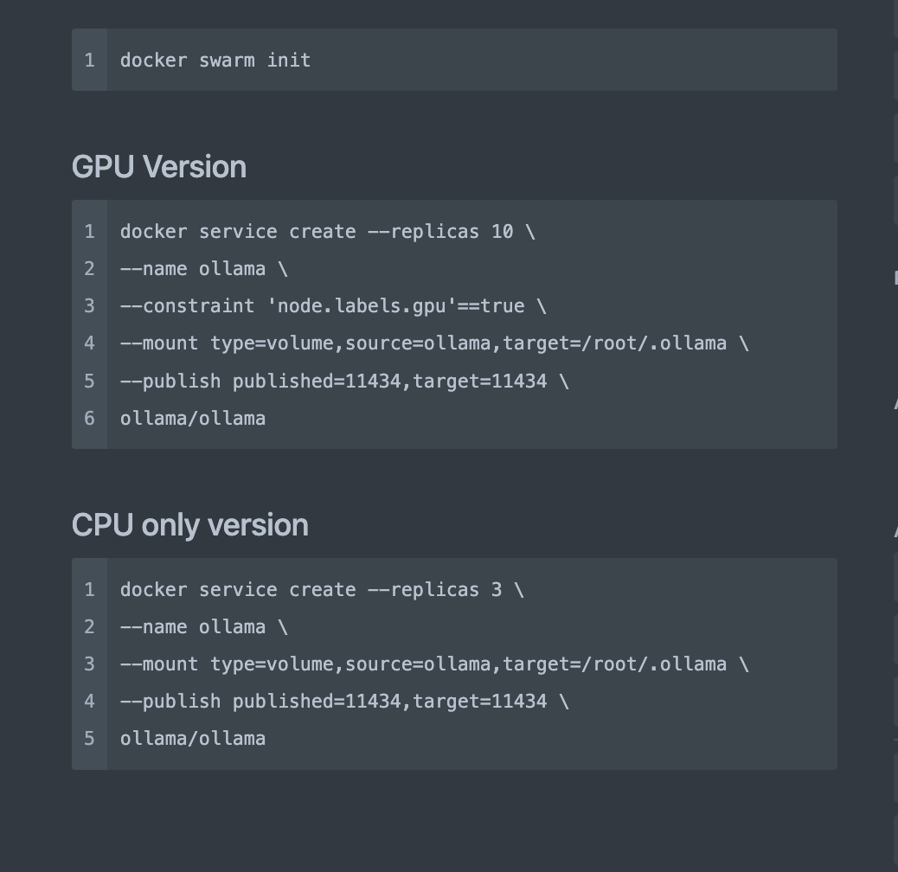

---

## Workaround

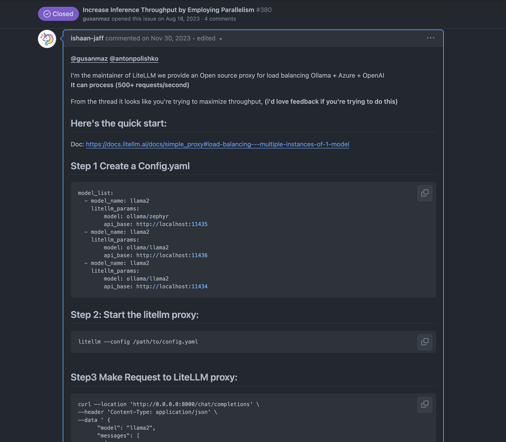

---

---

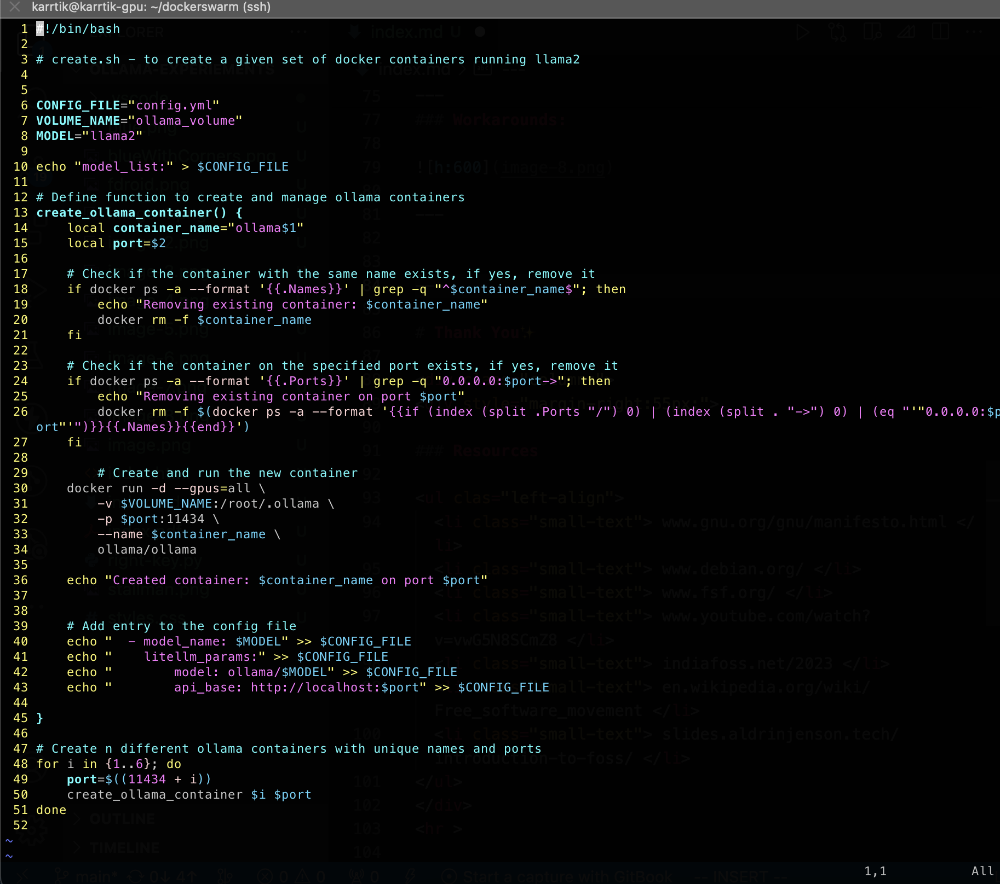

---

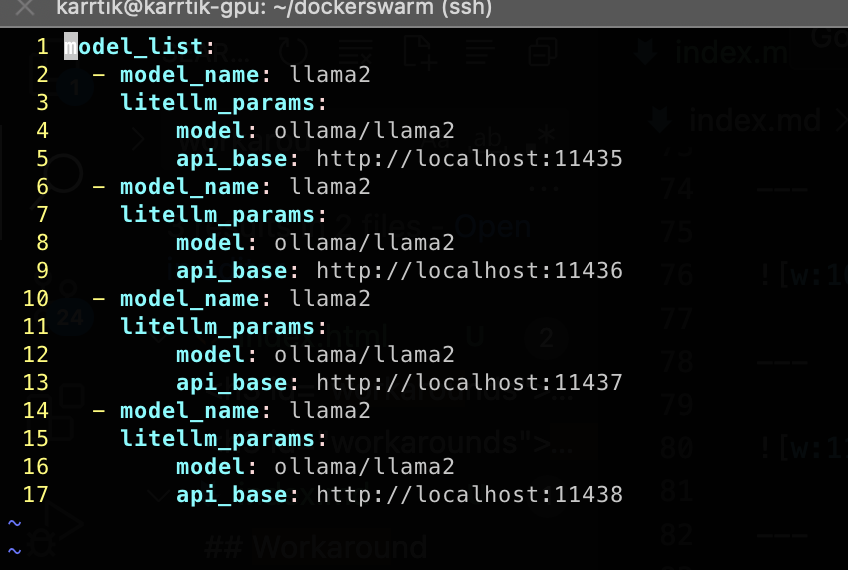

config.yml

---

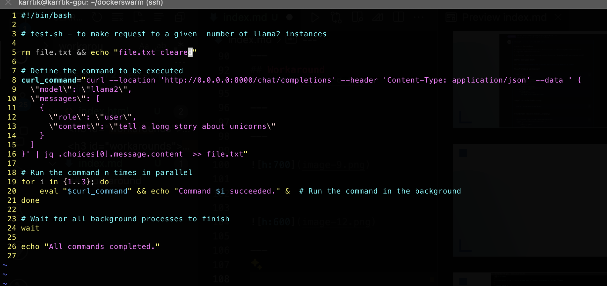

test.sh

---

## Observations

---

For 6 llama2 instances

- Sequential execution :: 41+ seconds.
- Parallel execution :: 18+ seconds.

---

## Limiting factor

---

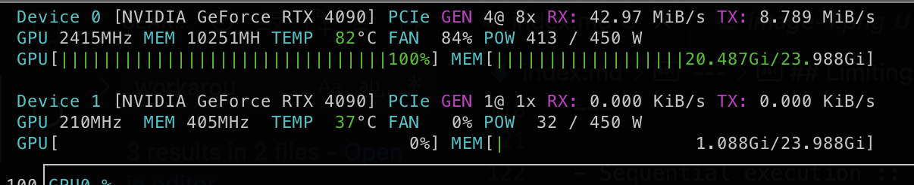

---

Still room to improve

---

# Thank You✨

### Resources

<ul clas="left-align">
  <li class="small-text"> www.gnu.org/gnu/manifesto.html </li> 
  <li class="small-text"> www.debian.org/ </li>
  <li class="small-text"> www.fsf.org/ </li>
  <li class="small-text"> www.youtube.com/watch?v=vwG5N8SCmZ8 </li>
  <li class="small-text"> indiafoss.net/2023 </li>
  <li class="small-text"> en.wikipedia.org/wiki/Free_software_movement </li>
  <li class="small-text"> slides.aldrinjenson.tech/introduction-to-foss/ </li>
</ul>

 

### May the **FOSS** be with you ⚔️

 

This presentation was built using Free Software 🤗

