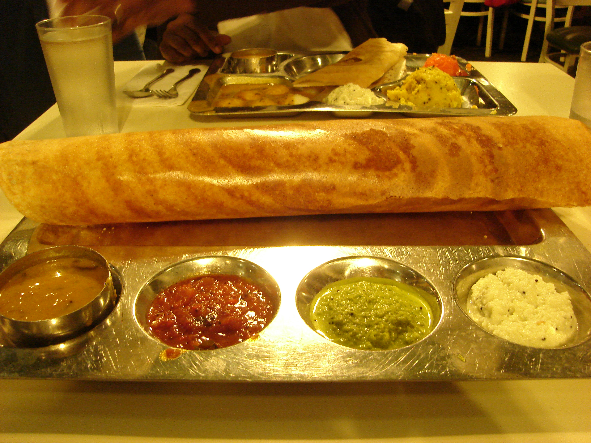
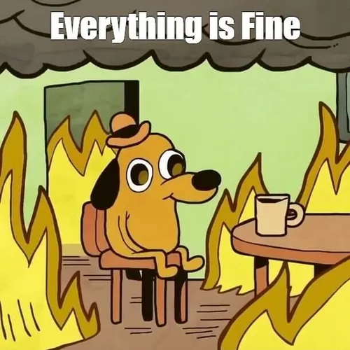
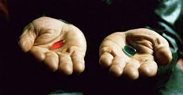
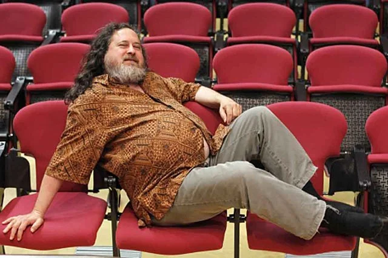
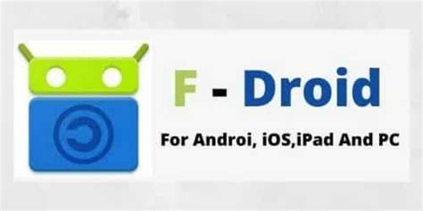

# Software **Freedoms**

Masala Dosa edition :)

<!-- Good evening -->
<!-- Let's learn about something new today! -->

---

---

<!--
## What kind of Software?

- the software that made **Mark Zuckerberg** drop out of Harward
- the software that lets us have a **smart-phone** for under 15k.
- the software that made **Jeff Bezoz** a billionaire

---

## This talk is also about

- Freedom
- Being a developer

### And about **Masala Dosa**

--- -->

---

---

## Having to pay, **but**

- Not able to share
- Not able to know what's inside
- Not able to modify

---

<!-- You feel restricted -->
<!-- not in control -->

<!--

--- -->

## Think it's unlikely?

Think again

<!-- today is your lucky day -->
<!-- introducing the hero -->

---

# Proprietary Software

- You pay money to buy software
- You **cannot** share with others what you bought
- You don't have the right to **know** how your program **functions**
- You can't make any modifications to the functionality

<!-- windows getting slow with each edition-->

---

## Seems a bit sad no?🥹

---

---

# Free software

Software that respects the freedom of users

---

- Freedom 0: The freedom to use the software for **any purpose**.

<!-- It's like having a bicycle that you can ride to school, use for exercise, or even decorate as a piece of art—it's your choice! -->

- Freedom 1: The freedom to **study** how the software works and **modify it**

<!-- Explanation: With Freedom 1, you can look at the "recipe" (the source code) of the software, see how it's made, and even change the ingredients (the code) if you want to make it better or suit your needs. -->

---

- Freedom 2: The freedom to **redistribute copies** of the software.

<!-- Explanation: imagine buying a book and sharing it with your friends after you have read it -->

- Freedom 3: The freedom to **distribute modified copies** of the software.

<!-- Example: Imagine you have a toy that you like, but you think it could be even better with some modifications. You can make those changes, and if your friends like them too, they can use your improved version of the toy. -->

---

## The Free Software Movement

<!-- read more about it -->

---

## Impacts

 

* Linux, BSD
* Firefox, Chromium
* Android
* VLC media player
* Blender

* Python, Ruby, PHP
* GNU core utils(ls, cat, echo, grep, gcc, gdb)
* Apache/Nginx
* Git

 

---

## Getting started

---

## Start small

<!-- you don't have to install Ubuntu right away! -->

- Look for the most common programs you use in your daily life
- Figure out if they are FOSS
- If not, see if you can switch to a FOSS alternative.

<u>alternativeto.net</u>

---

## F-DROID

---

## Other steps

- Consider **Linux**
  - Ditch Microsoft, choose Freedom!
- For Mobile, **Lineage OS** ftw

---

# Conclusion

---

## Given a choice, always consider the software

that

## **respects user freedom**

---

# Thank You✨

### Resources

<ul clas="left-align">
  <li class="small-text"> www.gnu.org/gnu/manifesto.html </li> 
  <li class="small-text"> www.debian.org/ </li>
  <li class="small-text"> www.fsf.org/ </li>
  <li class="small-text"> www.youtube.com/watch?v=vwG5N8SCmZ8 </li>
  <li class="small-text"> indiafoss.net/2023 </li>
  <li class="small-text"> en.wikipedia.org/wiki/Free_software_movement </li>
  <li class="small-text"> slides.aldrinjenson.tech/introduction-to-foss/ </li>
</ul>

 

### May the **FOSS** be with you ⚔️

 

This presentation was built using Free Software 🤗

