<!-- notes -->
<!-- make it relatable -->
<!-- talk about MEC -->

# Hello folks👋✨

Good evening
Let's learn about something new today!

---

## This talk is going to be about **software**

---

## what kind of software?

<!-- what kind of sotwre? -->
<!-- the -->

- the software that made Mark Zuckerberg a billionaire
- the tye that let's you have a **smart** phone for under 15k.
- the type that determines your **placements!**

---

## But that's not all

this talk is also about:

- Independence
- Respect
- Improving Developer Journey
- MEC

---

## Quick question

<!-- how many from cs background? -->
<!-- how many don't have ay programming experiece at all? -->
<!-- what is a program? -->

---

What is a **Program**?

---

A set of instructions written in code that is designed to perform specific tasks or functions **for the user** inorder to accomplish her objectives.

---

## Heard about **FOSS?**

<!-- ask about FOSS United -->
<!-- ask about IndiaFOSS -->

<!-- everyone know about FoSSMEC-->
<!-- how many of you clearly know why they exist -->

---

Another Question

---

Why MEC?

<!-- how many of  -->
<!-- ask why mec placements is so great? -->

---

<!-- and now, for the talk, -->

# Introduction to FOSS

What it really is
and
Why you **should care**

<!--  -->

---

## $whoami

## **Aldrin Jenson**

- Software Engineer at **Parseable**
- Volnter at **IndiaFOSS**
- MEC Alumni

---

# Okay, Let's now talk about **Masala Dosa**

<!-- can't share -->
<!-- can't modify -->
<!-- cant' see what's inside -->

<!-- what is FOSS -->
<!-- what comes to your mind when you hear about FOSS -->

---

# Let's get some basics clear

Just so we are all on the same page

<!-- what is FOSS -->
<!--  FSF Movement -->
<!--  -->

---

# In Propreitay Software,

---

You pay money to buy software

<!-- or ofc you get ads -->
<!-- you can use it till the specified duration -->

<!-- cracked sotware is an option -->
<!-- but, can you trust it -->

---

BUT

You can't share with others what you bought

---

You don't have the right to know how your program functions

<!-- tax software -->
<!-- you don't know whati is runnng behind the scees -->

---

You can't make any modification to the functionality

---

## Seems a bit sad no?🥹

---

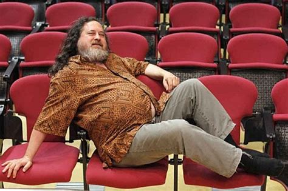

<!-- talk about the printer -->

<!-- in 1981 -->
<!-- xerox story -->

---

# Free software

---

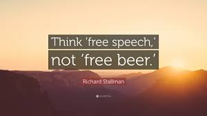

Any software which satisfies the **4 freedoms**

---

# The 4 Freedoms

---

<!-- expand to different sldes -->

## Freedom 0: The freedom to use the software for **any purpose**.

<!-- It's like having a bicycle that you can ride to school, use for exercise, or even decorate as a piece of art—it's your choice! -->

---

## Freedom 1: The freedom to **study** how the software works and **modify it**

<!-- Explanation: With Freedom 1, you can look at the "recipe" (the source code) of the software, see how it's made, and even change the ingredients (the code) if you want to make it better or suit your needs. -->

---

## Freedom 2: The freedom to **redistribute copies** of the software.

<!-- Explanation: imagin buying a book and shaing it with your
inds after you have read it -->

---

<!-- 150+ computers in MEC -->

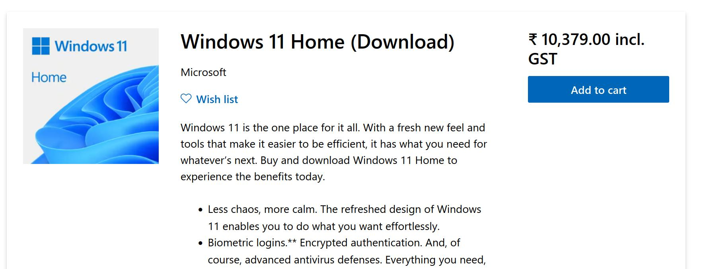

---

## Freedom 3: The freedom to **distribute modified copies** of the software.

<!-- Example: Imagine you have a toy that you like, but you think it could be even better with some modifications. You can make those changes, and if your friends like them too, they can use your improved version of the toy. -->

---

# The Free Software Movement

---

The GNU Project

---

# Impacts of FOSS

---

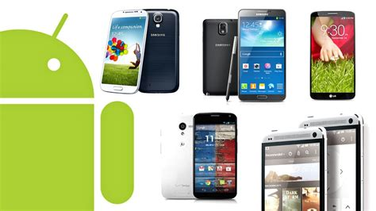

---

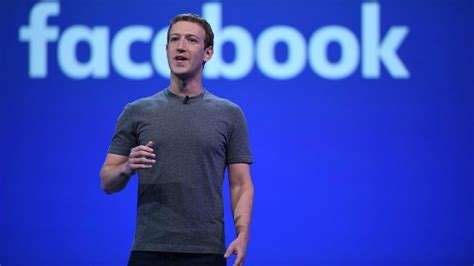

<!-- mark zucerberg -->
<!-- harward, 2004 -->

---

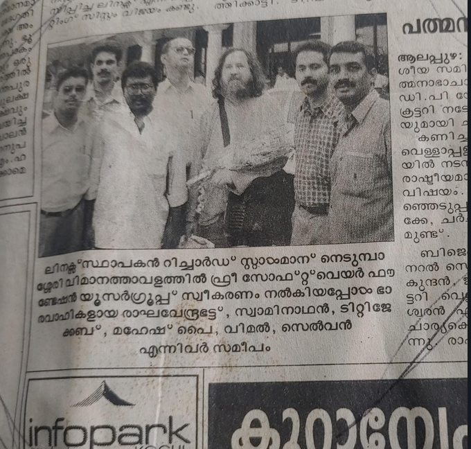

2002

<u>https://www.debian.org/users/edu/mec</u>

<!-- added in 2005 -->
<!-- only 5 institutions in India -->

<!-- immense opportunity to learn and explore -->

---

Almost any domain you can think of,
FOSS has had an impact

---

## Any questions so far?

---

This is why you should really care

---

Finally,

## FOSS is just better!

---

# Getting Started

---

## It's okay to start small

<!-- you don't have to install Ubuntu right away! -->

- Look for the most common programs you use in your daily life
- Figure out if they are FOSS
- If not, see if you can switch to a FOSS alternative.

<u>alternativeto.net</u>

<!-- google chrome example -->

---

## F-DROID

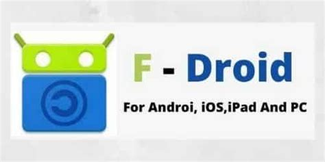

good to contribute as well

---

## Other steps

- Seriously Consider **Linux**
  - Ditch Microsoft, choose Freedom!
- Consider Lineage OS

---

## Join Communities

- FOSS United
- Linux User Groups
- Open Street Maps
- r/freesoftware r/foss

---

# Go for Conferences/Meetups

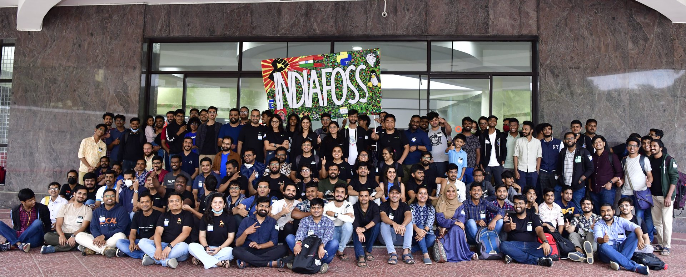

---

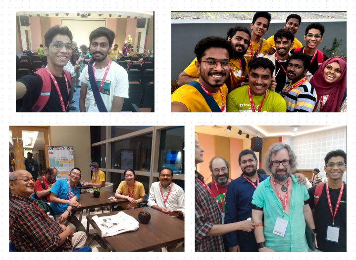

<!-- Debconf 2023 -->

---

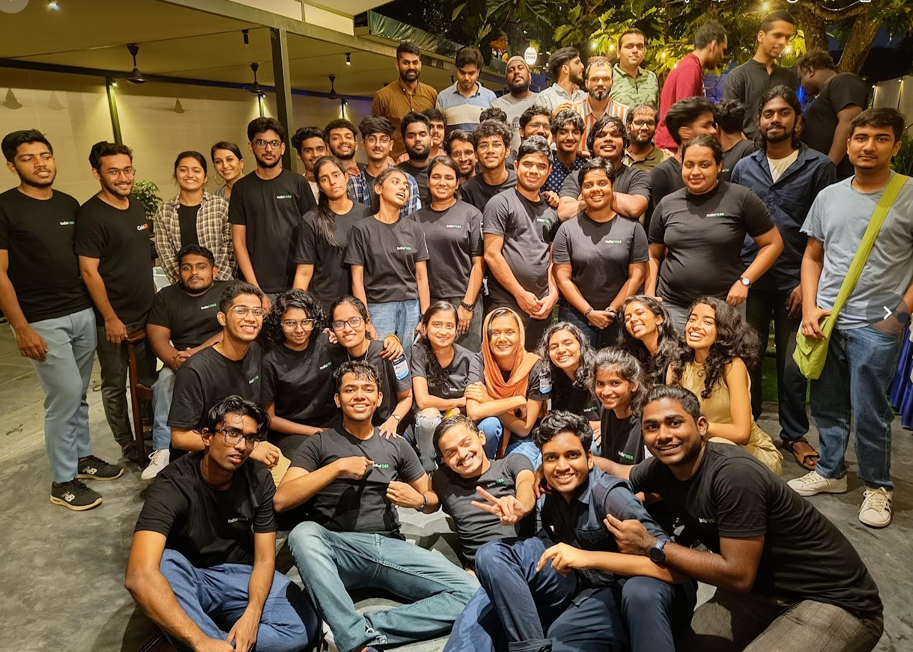

<!-- kochiFOSS 2022 -->

---

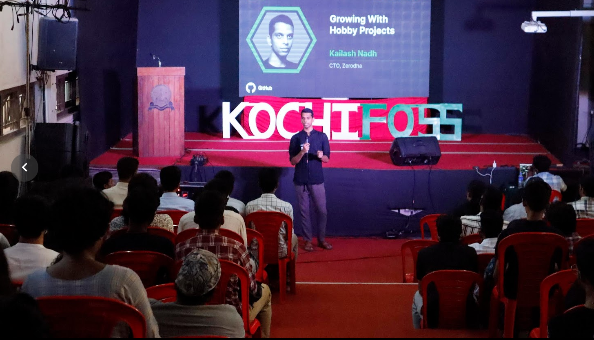

---

# Contributing back to the community

<!-- 5 slides on ways in which you can contribute back -->

- Bringing people into the resistance

---

## Preach!

Tell people about FOSS

<!-- start small -->
<!-- start communities -->

---

## Volunteer

Help make communites better

<!-- donate your time -->

---

If you like to code,

## Contribute Code

---

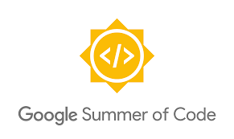

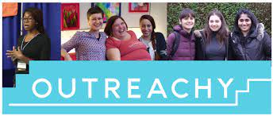

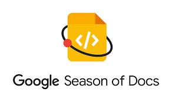

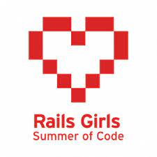

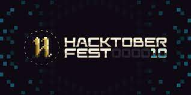

---

# Conclusion

---

# Thank You✨

### Shout out to

- SreeLaxmi
- Sreelakshmi

## **@aldrinjenson**

<u>aldrinjenson.tech</u>

 

This prsenation was buit with Free Software

---

---

---

# Approaches of looking at FOSS

1. FOSS is about **Challenging** the status quo

2. FOSS is about bringing **Freedom** to the user

3. FOSS is about **Community**

4. FOSS is about **Innovation and creativity**

5. FOSS is about **empowerment**

---

## 1. FOSS is about Challenging the status quo

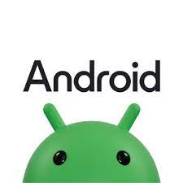

---

## 2. FOSS is about bringing **Freedom** to the user

---

## 3. FOSS is about **Community**

---

## 4. FOSS is about **Innovation and creativity**

---

## 5. FOSS is about **empowerment**
