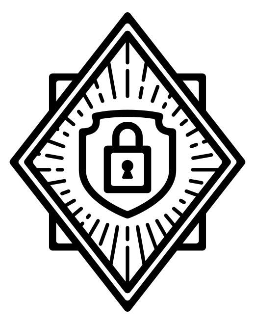
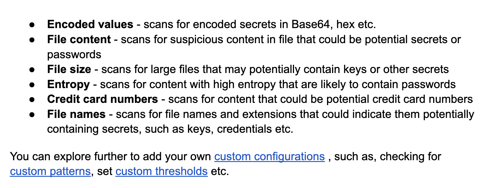
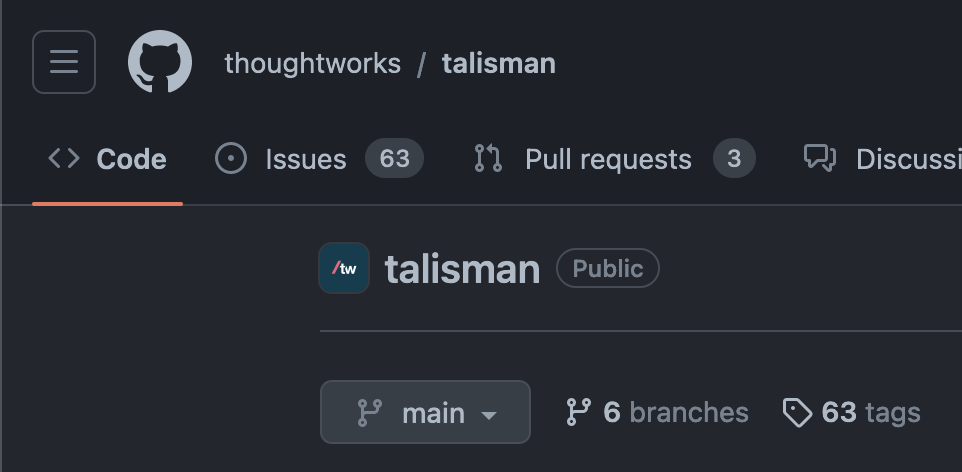
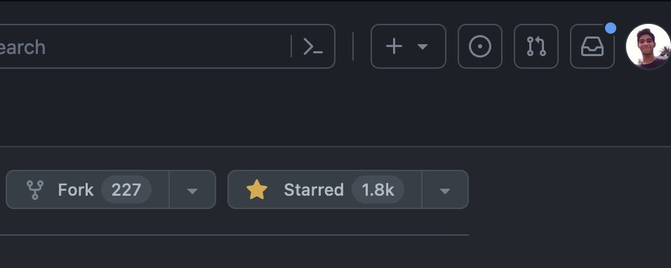

# Good afternoon folks!✨

<!-- Good evening -->
<!-- Let's learn about something new today! -->

---

<!--  -->

## This talk is going to be about a **Dev Tool**

---

## What kind of Dev Tool?

- One that trainers force us to use!
- One that lets us sleep peacefully at night as a SWE
- One that could _potentially_ prevent us from being sued for millions!

---

One that makes us proud to be at **ThoughtWorks**

<!-- pause here -->
<!-- what we're going to be talking about -->

---

## Let's start with a Problem

---

## /imagine

midjourney, anyone?

---

<!-- 

--- -->

## Well....

<!-- today is your lucky day -->
<!-- introducing the hero -->

---

# !**Talisman**!

"Keeping your secrets safe"

<!-- written in goLang -->

---

<!-- devtool that enforces the idea of -->

### Prevention is better than cure

---

- A tool that installs a **hook** to your git repository to ensure that potential **secrets or sensitive information** do not leave the developer's workstation.

---

- It validates the outgoing changeset for things that look suspicious - such as potential **SSH keys, authorization tokens, private keys** etc.

---

## Validation

---

 🤯

---

---

# Thank You✨

### Sources

- <u>github.com/thoughtworks/</u>
<u>talisman</u>
- <u>thoughtworks.github.io/</u>
<u>talisman/docs</u>

 

Go Star the Repo!

 

Made with  ❤️ by Aldrin  🤗 

